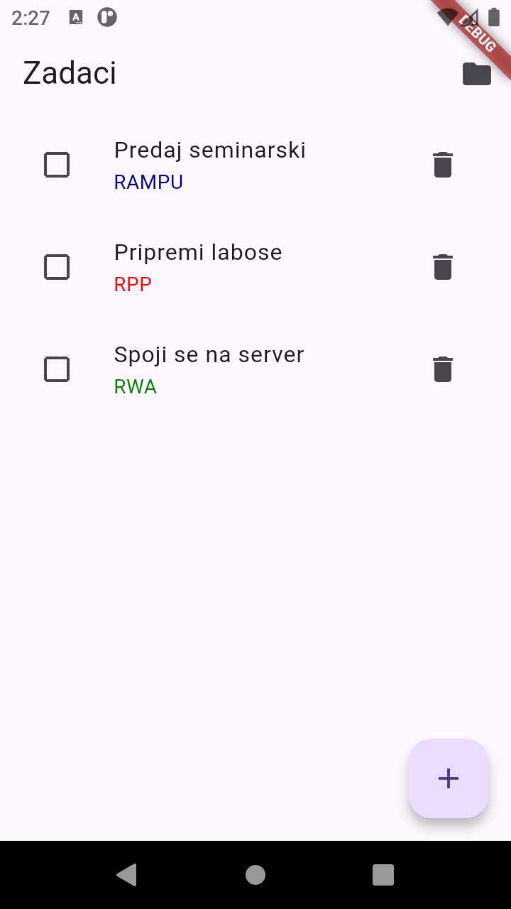
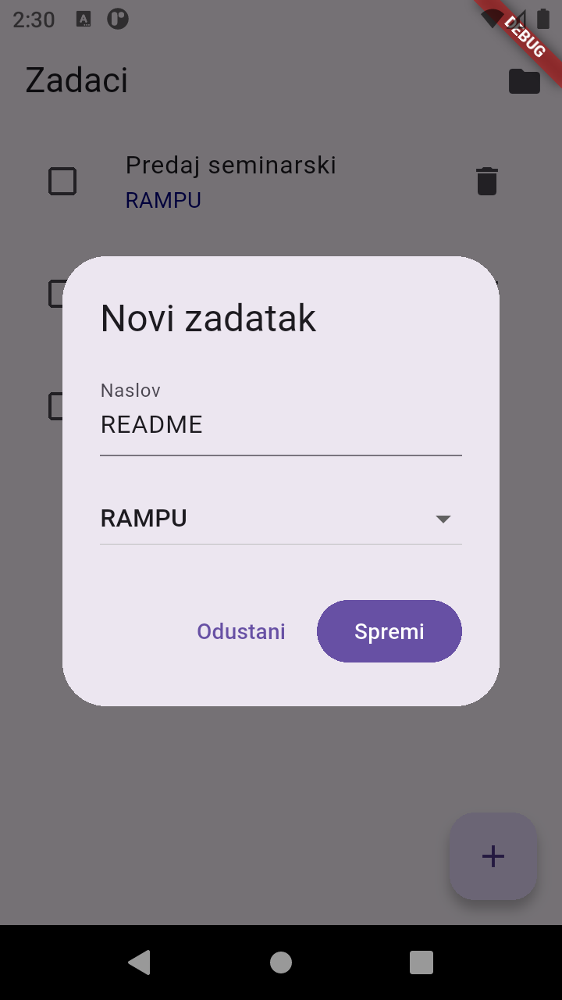
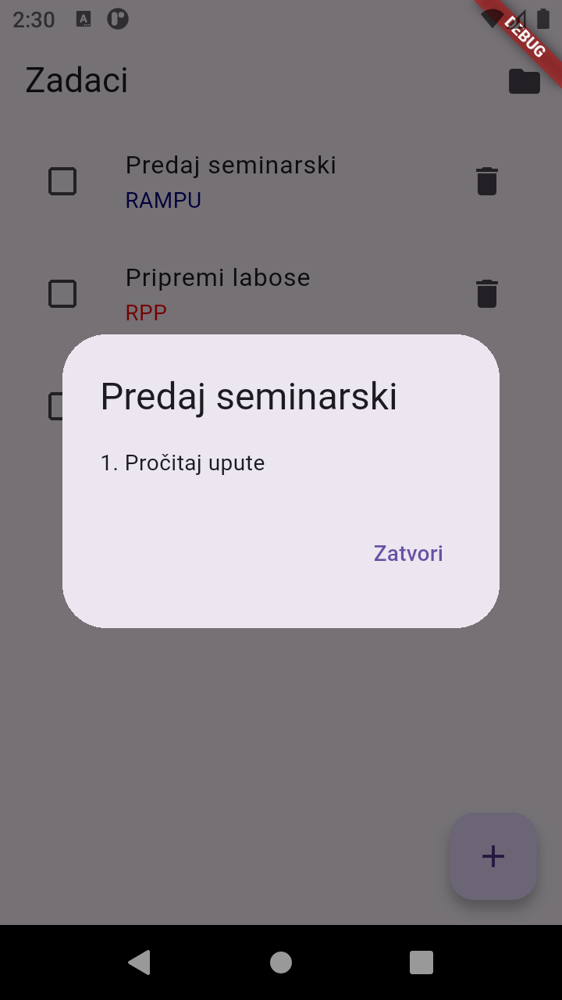
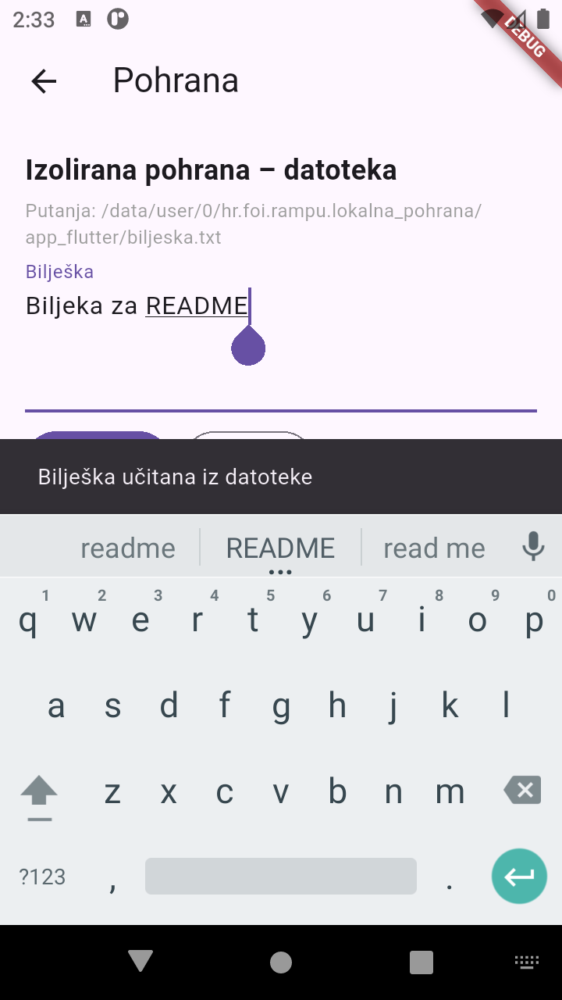
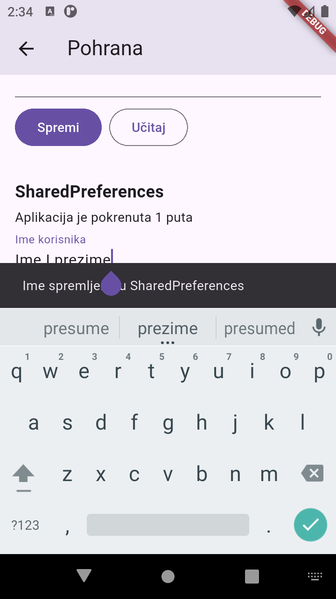

# Lokalna pohrana podataka u Flutteru

Demo projekt za seminar iz kolegija **Razvoj aplikacija za mobilne i pametne uređaje (RAMPU)**, FOI 2026./2027.

Autor: Oliver Vlaškovac

Aplikacija je pojednostavljena verzija aplikacije *Memento* s vježbi (zadaci po kategorijama), napravljena u Flutteru. Prikazuje tri načina lokalne pohrane podataka:


---

## Sadržaj

0. [Pokretanje projekta](#0-pokretanje-projekta)
1. [Struktura projekta](#1-struktura-projekta)
2. [Kreiranje baze i tablica](#2-kreiranje-baze-i-tablica)
3. [Otvaranje baze – UpraviteljBaze](#3-otvaranje-baze--upraviteljbaze)
4. [Upis, izmjena, brisanje i selekcija (DAO)](#4-upis-izmjena-brisanje-i-selekcija-dao)
5. [Spajanje tablica – INNER JOIN i NATURAL JOIN](#5-spajanje-tablica--inner-join-i-natural-join)
6. [Verzioniranje baze i slabi entitet](#6-verzioniranje-baze-i-slabi-entitet)
7. [Izolirana pohrana – datoteke](#7-izolirana-pohrana--datoteke)
8. [SharedPreferences](#8-sharedpreferences)
9. [Literatura](#9-literatura)

---

## 0. Pokretanje projekta

Potrebno je imati instaliran Flutter SDK i Android Studio (s Flutter pluginom) te Android emulator ili uređaj.

```
git clone https://github.com/ovlaskova24/rampu-lokalna-pohrana-flutter.git
cd rampu-lokalna-pohrana-flutter
flutter pub get
flutter run
```

Korišteni paketi dodani su naredbom:

```
flutter pub add sqflite path path_provider shared_preferences
```

> Na Windowsima je za pluginove potrebno uključiti **Developer Mode** (`start ms-settings:developers`).
>
> Za pokretanje u Chromeu dodan je i paket `sqflite_common_ffi_web` (`dart run sqflite_common_ffi_web:setup`). Datotečna pohrana u pregledniku ne radi – aplikaciju je najbolje pokretati na Android emulatoru.

---

## 1. Struktura projekta

Projekt je podijeljen u slojeve – ekran nikad ne piše SQL, nego poziva DAO, a DAO bazu dobiva od klase `UpraviteljBaze`.

```
lokalna_pohrana/
├── assets/sql/
│   ├── kreirajBazu.sql          – verzija 1 baze
│   └── azurirajBazu_v2.sql      – verzija 2 baze
└── lib/
    ├── main.dart                – ulazna točka aplikacije
    ├── interface/               – klase koje opisuju jedan redak tablice
    │   ├── kategorija.dart
    │   ├── zadatak.dart
    │   └── podzadatak.dart
    ├── podaci/                  – rad s bazom
    │   ├── upravitelj_baze.dart – otvaranje, kreiranje i nadogradnja baze
    │   ├── kategorija_dao.dart
    │   ├── zadatak_dao.dart
    │   └── podzadatak_dao.dart
    ├── pohrana/                 – datoteke i postavke
    │   ├── datotecna_pohrana.dart
    │   └── postavke.dart
    └── aplikacija/              – ekrani
        ├── baza_ekran.dart
        └── pohrana_ekran.dart
```

Shema baze:

```
kategorija 1 ──── N zadatak 1 ──── N podzadatak (slabi entitet)
```

---

## 2. Kreiranje baze i tablica

Tablice se kreiraju SQL skriptom koja se nalazi u `assets/sql/kreirajBazu.sql`:

```sql
CREATE TABLE kategorija (
    kategorija_id    INTEGER PRIMARY KEY AUTOINCREMENT,
    naziv_kategorije TEXT    NOT NULL UNIQUE,
    boja             TEXT    NOT NULL
);

CREATE TABLE zadatak (
    zadatak_id    INTEGER PRIMARY KEY AUTOINCREMENT,
    naslov        TEXT    NOT NULL,
    zavrsen       INTEGER NOT NULL DEFAULT 0 CHECK (zavrsen IN (0, 1)),
    kategorija_id INTEGER NOT NULL,
    FOREIGN KEY (kategorija_id) REFERENCES kategorija (kategorija_id)
        ON DELETE RESTRICT
);

INSERT INTO kategorija (naziv_kategorije, boja) VALUES ('RAMPU', '#000080');
INSERT INTO kategorija (naziv_kategorije, boja) VALUES ('RPP', '#FF0000');
INSERT INTO kategorija (naziv_kategorije, boja) VALUES ('RWA', '#008000');

INSERT INTO zadatak (naslov, kategorija_id) VALUES ('Predaj seminarski', 1);
INSERT INTO zadatak (naslov, kategorija_id) VALUES ('Pripremi labose', 2);
INSERT INTO zadatak (naslov, kategorija_id) VALUES ('Spoji se na server', 3);
```

Napomene:

- SQLite nema tip `BOOLEAN` ni `DATE` – boolean se sprema kao `INTEGER` (0 ili 1).
- `ON DELETE RESTRICT` – kategorija koja ima zadatke ne može se obrisati.
- Stupci namjerno imaju **jedinstvene nazive** (`naziv_kategorije`, `naslov`) kako bi radio `NATURAL JOIN` (vidi korak 5).

Da bi se skripta zapakirala u aplikaciju, mapa se navodi u `pubspec.yaml`:

```yaml
flutter:
  uses-material-design: true

  assets:
    - assets/sql/
```

---

## 3. Otvaranje baze – UpraviteljBaze

`lib/podaci/upravitelj_baze.dart` je **Singleton** – u cijeloj aplikaciji postoji jedna veza na bazu (isto kao `TasksDatabase.getInstance()` u Kotlinu s vježbi).

```dart
import 'package:flutter/services.dart' show rootBundle;
import 'package:sqflite/sqflite.dart';

class UpraviteljBaze {
  UpraviteljBaze._();
  static final UpraviteljBaze instanca = UpraviteljBaze._();

  static const String _nazivBaze = 'memento.db';
  static const int _verzija = 2;

  Future<Database>? _baza;

  Future<Database> get baza => _baza ??= _otvori();

  Future<Database> _otvori() {
    return openDatabase(
      _nazivBaze,
      version: _verzija,

      // pri svakom otvaranju – SQLite strane ključeve inače ignorira
      onConfigure: (db) async {
        await db.execute('PRAGMA foreign_keys = ON');
      },

      // baza NE postoji – izvrši sve skripte
      onCreate: (db, verzija) async {
        await _izvrsiSkriptu(db, 'assets/sql/kreirajBazu.sql');
        await _izvrsiSkriptu(db, 'assets/sql/azurirajBazu_v2.sql');
      },

      // baza postoji, ali je starija verzija – izvrši samo ono što nedostaje
      onUpgrade: (db, staraVerzija, novaVerzija) async {
        if (staraVerzija < 2) {
          await _izvrsiSkriptu(db, 'assets/sql/azurirajBazu_v2.sql');
        }
      },
    );
  }

  // čita .sql datoteku iz assets i izvršava naredbu po naredbu
  Future<void> _izvrsiSkriptu(Database db, String putanja) async {
    String sadrzaj = await rootBundle.loadString(putanja);
    List<String> dijelovi = sadrzaj.split(';');

    for (String dio in dijelovi) {
      String naredba = dio.trim();
      if (naredba.isEmpty) {
        continue;
      }
      await db.execute(naredba);
    }
  }
}
```

| Funkcija | Kada se poziva |
|---|---|
| `onConfigure` | pri svakom otvaranju baze |
| `onCreate` | samo kad baza na uređaju još ne postoji |
| `onUpgrade` | kad je verzija baze na uređaju manja od verzije u kodu |

U `main.dart` se prije pokretanja aplikacije poziva `WidgetsFlutterBinding.ensureInitialized()`, jer se koriste pluginovi.

---

## 4. Upis, izmjena, brisanje i selekcija (DAO)

Klase u mapi `interface` opisuju jedan redak tablice:

```dart
class Zadatak {
  final int? id;            // null dok ga baza ne dodijeli
  final String naslov;
  final bool zavrsen;
  final int kategorijaId;

  final String? nazivKategorije;   // popunjeno kod spajanja s kategorijom
  final String? boja;

  Zadatak({
    this.id,
    required this.naslov,
    this.zavrsen = false,
    required this.kategorijaId,
    this.nazivKategorije,
    this.boja,
  });
}
```

Svi SQL upiti nalaze se u DAO klasama. Primjer iz `lib/podaci/zadatak_dao.dart`:

```dart
class ZadatakDAO {
  // SELECT
  Future<List<Zadatak>> dohvatiSve() async {
    var baza = await UpraviteljBaze.instanca.baza;
    var redci = await baza.rawQuery('SELECT * FROM zadatak');

    List<Zadatak> zadaci = [];
    for (var redak in redci) {
      zadaci.add(Zadatak(
        id: redak['zadatak_id'] as int,
        naslov: redak['naslov'] as String,
        zavrsen: redak['zavrsen'] == 1,
        kategorijaId: redak['kategorija_id'] as int,
      ));
    }
    return zadaci;
  }

  // INSERT
  Future<void> dodaj(Zadatak zadatak) async {
    var baza = await UpraviteljBaze.instanca.baza;
    await baza.rawInsert(
      'INSERT INTO zadatak (naslov, kategorija_id) VALUES (?, ?)',
      [zadatak.naslov, zadatak.kategorijaId],
    );
  }

  // UPDATE
  Future<void> postaviZavrsen(int id, bool zavrsen) async {
    var baza = await UpraviteljBaze.instanca.baza;
    var vrijednost = 0;
    if (zavrsen) {
      vrijednost = 1;
    }
    await baza.rawUpdate(
      'UPDATE zadatak SET zavrsen = ? WHERE zadatak_id = ?',
      [vrijednost, id],
    );
  }

  // DELETE
  Future<void> obrisi(int id) async {
    var baza = await UpraviteljBaze.instanca.baza;
    await baza.rawDelete('DELETE FROM zadatak WHERE zadatak_id = ?', [id]);
  }
}
```

| Metoda | SQL | Vraća |
|---|---|---|
| `rawQuery` | SELECT | listu redaka (`Map`) |
| `rawInsert` | INSERT | ID novog retka |
| `rawUpdate` | UPDATE | broj promijenjenih redaka |
| `rawDelete` | DELETE | broj obrisanih redaka |

Vrijednosti se predaju umjesto upitnika `?` – nikad se ne lijepe izravno u SQL (zaštita od SQL injectiona).

Na ekranu (`baza_ekran.dart`) kvačica poziva `postaviZavrsen`, ikona kante `obrisi`, a gumb **+** otvara prozor za novi zadatak koji poziva `dodaj`. Nakon svake akcije lista se ponovno učitava.




---

## 5. Spajanje tablica – INNER JOIN i NATURAL JOIN

Zadatak u bazi ima samo `kategorija_id`. Da bi se prikazao naziv i boja kategorije, tablice se spajaju.

**INNER JOIN** – stupac spajanja navodi se ručno:

```dart
var redci = await baza.rawQuery(
  'SELECT * FROM zadatak '
  'INNER JOIN kategorija ON zadatak.kategorija_id = kategorija.kategorija_id',
);
```

**NATURAL JOIN** – baza sama spaja po svim stupcima **istog imena**:

```dart
var redci = await baza.rawQuery(
  'SELECT * FROM zadatak NATURAL JOIN kategorija',
);
```

Oba upita daju isti rezultat jer je jedini zajednički stupac `kategorija_id`. Da obje tablice imaju npr. stupac `naziv`, NATURAL JOIN bi spajao i po njemu i rezultat bi bio pogrešan – zato su nazivi stupaca jedinstveni.

Jedan redak rezultata sadrži stupce obje tablice, pa se iz njega popunjavaju i podaci o zadatku i o kategoriji (`nazivKategorije`, `boja`).

---

## 6. Verzioniranje baze i slabi entitet

### Slabi entitet

**Podzadatak** ne postoji bez zadatka i nema vlastiti identifikator. Identificira ga ključ vlasnika (`zadatak_id`) i parcijalni ključ (`redni_broj`) – **složeni primarni ključ**.

| zadatak_id | redni_broj | opis |
|---|---|---|
| 1 | 1 | Napravi slajdove |
| 1 | 2 | Snimi screenshotove |
| 2 | 1 | Pročitaj upute |

### Verzija 2 baze

Tablica se dodaje kao nova verzija baze, skriptom `assets/sql/azurirajBazu_v2.sql`:

```sql
CREATE TABLE podzadatak (
    zadatak_id INTEGER NOT NULL,
    redni_broj INTEGER NOT NULL,
    opis       TEXT    NOT NULL,
    obavljen   INTEGER NOT NULL DEFAULT 0 CHECK (obavljen IN (0, 1)),
    PRIMARY KEY (zadatak_id, redni_broj),
    FOREIGN KEY (zadatak_id) REFERENCES zadatak (zadatak_id)
        ON DELETE CASCADE
);

INSERT INTO podzadatak (zadatak_id, redni_broj, opis)
SELECT zadatak_id, 1, 'Pročitaj upute' FROM zadatak;
```

- `ON DELETE CASCADE` – brisanjem zadatka brišu se i njegovi podzadaci.
- Zadnja naredba je **migracija podataka**: svakom postojećem zadatku dodaje jedan podzadatak.

U `UpraviteljBaze` se `_verzija` poveća na **2** i doda se `onUpgrade` (vidi korak 3):

| Baza na uređaju | Verzija u kodu | Poziva se |
|---|---|---|
| ne postoji | 2 | `onCreate` – obje skripte |
| verzija 1 | 2 | `onUpgrade` – samo `azurirajBazu_v2.sql` |
| verzija 2 | 2 | ništa |

Korisnik koji ima staru verziju aplikacije tako dobiva novu tablicu, a **njegovi podaci ostaju sačuvani**. (Za razliku od `fallbackToDestructiveMigration` u Roomu, koji bazu briše.)

Podzadaci se dohvaćaju prirodnim spojem (`lib/podaci/podzadatak_dao.dart`):

```dart
var redci = await baza.rawQuery(
  'SELECT * FROM zadatak NATURAL JOIN podzadatak '
  'WHERE zadatak_id = ? ORDER BY redni_broj',
  [zadatakId],
);
```

Dodirom zadatka na ekranu otvara se prozor s njegovim podzacima.



---

## 7. Izolirana pohrana – datoteke

Svaka aplikacija na uređaju dobiva vlastiti privatni direktorij kojem druge aplikacije ne mogu pristupiti i koji se briše zajedno s aplikacijom. U njemu se nalazi i baza `memento.db`. Paket `path_provider` vraća putanju do tog direktorija, a datoteka se čita i piše klasom `File` iz `dart:io`.

`lib/pohrana/datotecna_pohrana.dart`:

```dart
import 'dart:io';

import 'package:path_provider/path_provider.dart';

class DatotecnaPohrana {
  Future<File> _datoteka() async {
    var mapa = await getApplicationDocumentsDirectory();
    return File('${mapa.path}/biljeska.txt');
  }

  Future<String> putanja() async {
    var datoteka = await _datoteka();
    return datoteka.path;
  }

  Future<void> spremi(String tekst) async {
    var datoteka = await _datoteka();
    await datoteka.writeAsString(tekst);
  }

  Future<String> ucitaj() async {
    var datoteka = await _datoteka();
    if (await datoteka.exists()) {
      return await datoteka.readAsString();
    }
    return '';
  }
}
```

Ekran **Pohrana** otvara se ikonom mape na glavnom ekranu. Gumb **Spremi** zapisuje tekst u datoteku, a **Učitaj** ga čita natrag.



---

## 8. SharedPreferences

Za male vrijednosti (postavke, ime korisnika) koristi se `shared_preferences` – parovi **ključ → vrijednost** (`int`, `double`, `bool`, `String`, `List<String>`). Koristi se preporučeni `SharedPreferencesAsync` API.

`lib/pohrana/postavke.dart`:

```dart
import 'package:shared_preferences/shared_preferences.dart';

class Postavke {
  var _prefs = SharedPreferencesAsync();

  Future<String> dohvatiIme() async {
    var ime = await _prefs.getString('ime_korisnika');
    if (ime == null) {
      return '';
    }
    return ime;
  }

  Future<void> spremiIme(String ime) async {
    await _prefs.setString('ime_korisnika', ime);
  }

  Future<int> dohvatiBrojPokretanja() async {
    var broj = await _prefs.getInt('broj_pokretanja');
    if (broj == null) {
      return 0;
    }
    return broj;
  }

  Future<void> povecajBrojPokretanja() async {
    var broj = await dohvatiBrojPokretanja();
    await _prefs.setInt('broj_pokretanja', broj + 1);
  }
}
```

U `main.dart` se pri svakom pokretanju poziva `await Postavke().povecajBrojPokretanja();`. Nakon ponovnog pokretanja aplikacije broj je veći, a spremljeno ime je i dalje upisano.



---

## 9. Literatura

1. Flutter, „Persist data with SQLite”, https://docs.flutter.dev/cookbook/persistence/sqlite
2. Flutter, „Persistent storage architecture: SQL”, https://docs.flutter.dev/app-architecture/design-patterns/sql
3. Flutter, „Read and write files”, https://docs.flutter.dev/cookbook/persistence/reading-writing-files
4. Flutter, „Store key-value data on disk”, https://docs.flutter.dev/cookbook/persistence/key-value
5. sqflite, https://pub.dev/packages/sqflite
6. path_provider, https://pub.dev/packages/path_provider
7. shared_preferences, https://pub.dev/packages/shared_preferences
8. sqflite_common_ffi_web, https://pub.dev/packages/sqflite_common_ffi_web
9. SQLite, „Foreign Key Support”, https://www.sqlite.org/foreignkeys.html
10. Android Developers, „Save data in a local database using Room”, https://developer.android.com/training/data-storage/room
11. Android Developers, „Access app-specific files”, https://developer.android.com/training/data-storage/app-specific

Svi izvori pristupljeni 22. 11. 2026.